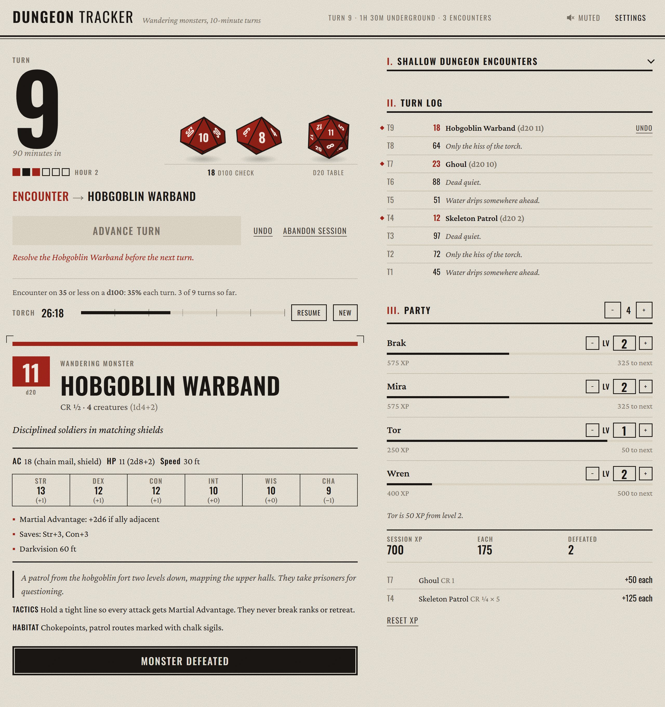

# Dungeon Tracker

A turn tracker for running dungeon crawls in D&D 5e. Each press advances one 10-minute exploration turn, rolls for wandering monsters, and puts the stat block in front of the GM when something turns up.

**[tracker.dungeongadgets.com](https://tracker.dungeongadgets.com/)**

<picture>
  <source media="(prefers-color-scheme: dark)" srcset="docs/screenshot-dark.png">
  
</picture>

## Features

- **Turns and wandering monsters.** Advance a turn and the app rolls the encounter check (d100, d20, d12 or d6 against a threshold you set), then the d20 encounter table. The dice are thrown on screen and land on the result.
- **Encounters.** The monster's stat block, lore, tactics and habitat, with the group size already rolled. The next turn stays locked until the encounter is resolved.
- **Time.** A turn count, an hour track of six turns, and a real-time torch timer that keeps burning while the page is closed.
- **XP.** Defeating a monster splits its XP across the party using the 5e encounter multipliers. Level-ups are tracked to 20, and undo takes back XP along with the turn.
- **Three built-in tables** (Shallow, Deep, Abyss) or your own, uploaded as CSV or JSON.
- Light and dark modes, keyboard play (Space to advance, Ctrl+Z to undo), and the session saves itself in the browser.

## Custom encounter tables

Upload a table from **Settings → Encounter table**. It replaces the built-in table for that tier until you remove it. Use **Download template** to start from the current table.

CSV, one row per d20 result:

```csv
roll,name,cr,count,desc
1,Giant Rats,CR 1/8,2d4,Squealing in the walls
2,Ghoul,CR 1,1,A hunched figure feeding on a corpse
```

JSON takes the same fields, plus optional `lore`, `tactics`, `habitat` and a `stats` block:

```json
[
  { "roll": 2, "name": "Ghoul", "cr": "CR 1", "count": "1", "desc": "A hunched figure feeding on a corpse",
    "lore": "Once a grave robber who ate the dead to survive." }
]
```

Files can be up to 1 MB and 100 rows. `count` accepts a number or dice (`1d4+2`).

## Running locally

It's plain HTML, CSS and JavaScript with no build step and no dependencies. Serve the folder with any static server:

```bash
python -m http.server 8080
```

Then open <http://localhost:8080>. Tests use Node's built-in runner:

```bash
node --test
```

| Path | What's in it |
|---|---|
| `index.html`, `css/app.css` | Markup and styles |
| `js/rules.js` | Dice, XP and encounter rules (pure, tested) |
| `js/state.js` | Session state and save migration (pure, tested) |
| `js/tables.js` | CSV and JSON table parsing (pure, tested) |
| `js/dice.js` | The 3D dice, drawn on a canvas |
| `js/audio.js` | Sound effects, synthesised with Web Audio |
| `js/app.js` | Rendering, actions and events |
| `js/data.js` | The built-in encounter tables |

## Licence

The code is released under the [MIT Licence](LICENSE).

Game mechanics come from the *System Reference Document 5.1*, used under the Open Game License 1.0a; the full notice is in the app's footer. This is an unofficial fan tool, not affiliated with or endorsed by Wizards of the Coast.
